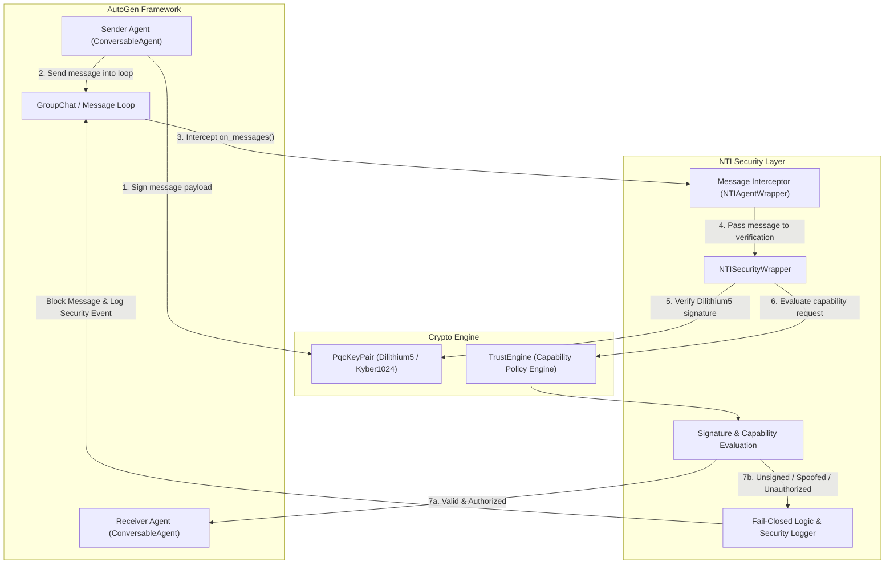

# autogen-nti

Drop-in post-quantum security for AutoGen and Microsoft Agent Framework, powered by NTI (Neutral Trust Infrastructure).

## Install

pip install autogen-nti

## Usage

from autogen_nti import NTISecurityWrapper

wrapper = NTISecurityWrapper(agent_id="finance_agent")
wrapper.grant_capability("execute_transfer")

# Verify an incoming message before processing
is_allowed = wrapper.verify_message(
    capability="execute_transfer",
    message={"action": "transfer", "amount": 100}
)

## What it enforces (all 5 pillars)

1. Zero-Trust Capability Enforcement
2. NIST Post-Quantum Cryptography (Dilithium5 / Kyber1024)
3. BFT Multi-Agent Consensus
4. Merkle-Chained Audit Trails
5. P2P Agent Mesh & State Persistence

## License

Apache License 2.0. See LICENSE.

## Links

- Core SDK: https://pypi.org/project/ube-foundation/
- Homepage: https://abisheakp197.github.io/Neutral-Trust-Infrastructure/

## Architecture

